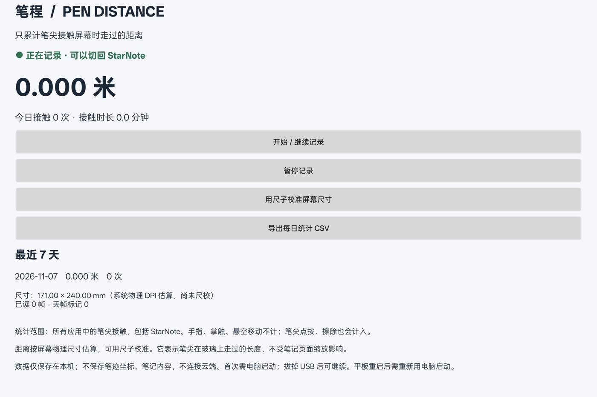

# 笔程 · PenDistance

在 Android 平板后台累计**笔尖接触玻璃时的移动距离**。继续使用 StarNote 或其他笔记软件，不必更换笔记应用。

当前是 **v0.1.0 实验版**：已在 OPPO Pad 3 完成安装、本机连接、保存、暂停与核心算法测试；真实笔迹增量和尺子对照仍待用户实测。详细范围见 [验证记录](VALIDATION.md)。



## 当前设备与边界

- 已识别设备：OPPO Pad 3（OPD2405），Android 16，OPPO Pencil。
- 通过独立的 `touchpanel_pen` 输入设备区分笔与手指；使用 `BTN_TOUCH` 区分接触和悬空。
- 距离是笔尖在**实体屏幕**上的移动距离，不是缩放后的文档坐标或导出 PDF 的线长。
- 所有应用中的笔尖接触均会计入，包括界面点按、橡皮擦和画图；不识别语义上的“写字”。
- 当前版本并非 StarNote 的官方插件，也不读取或修改 StarNote 的数据库。
- 可脱离电脑在平板上记录；**平板每次重启后，需要通过 USB 重新启动记录程序**。每日汇总不会因此清零。
- 不需要 root 或 Shizuku 的前提是该设备允许 ADB shell 读取笔输入。其他机型需先测试，不保证通用。

## 使用

1. 从本仓库 Releases 获取 Windows 完整包并解压（包含启动脚本和 APK），或获取源码后自行构建。单独的 `PenDistance.apk` 只包含平板应用。
2. 电脑安装 Android Platform Tools 和 Python 3；平板启用 USB 调试并授权这台电脑。
3. 执行启动脚本。它会识别专用笔设备、安装应用，并启动**平板本机**的记录程序：

   ```powershell
   python start.py --apk .\dist\PenDistance.apk
   ```

   默认寻找 `%LOCALAPPDATA%\Android\Sdk\platform-tools\adb.exe`。其他位置：

   ```powershell
   python start.py --adb C:\platform-tools\adb.exe --apk .\PenDistance.apk
   ```

4. 在平板完成 OPPO 的安装确认；如电脑提示超时，确认安装后重新执行即可。打开“笔程”，允许通知，以便看到记录状态。
5. 当界面显示“正在记录”后，可切回 StarNote，并拔掉 USB。
6. “暂停记录”停止累计；“开始 / 继续记录”恢复。统计可导出 CSV。

更新程序后，如果需要重新加载记录内核：

```powershell
python start.py --apk .\dist\PenDistance.apk --restart
```

平板重启后，如果应用已安装且版本相同，可跳过重新安装：

```powershell
python start.py --apk .\dist\PenDistance.apk --skip-install
```

Windows 上也可以直接双击完整包里的 `start-recording.cmd`。它只适用于应用已安装的情况。

### 校准

初始值按系统报告的物理 `xDpi/yDpi` 换算，不使用 Android 的界面缩放密度。系统 DPI 也可能有偏差。

用尺子量**发光显示区域**的短边和长边（不含边框），在“用尺子校准屏幕尺寸”中按竖屏方向填写毫米值。校准只影响之后的距离，不追溯重算旧汇总。

沿尺子画 100 mm 直线，比较计数增量，重复数次；手抖、触点噪声、有限采样率、屏幕边缘和笔尖位置偏差都会造成误差。本项目不把未经尺校的数据称为精密测量。

## 原理与隐私

```text
OPPO Pencil → 专用笔输入设备 → 平板上的 shell 记录程序
                                    ↓
                           每日距离 / 接触次数 / 时长
                                    ↓
                        笔程 App + 状态通知 + CSV
```

USB 仅用于安装和启动。记录程序通过 `app_process` 以 shell 身份运行；应用本身不拥有 root 权限，也不劫持、转发或注入触控事件。

每个 `SYN_REPORT` 代表一个完整输入帧。帧之间按欧氏距离累计，抬笔后断开轨迹，避免把 X、Y 更新分别累计，或把两笔间的悬空距离误算进去。检测到 `SYN_DROPPED` 时断开轨迹，等待新的落笔，优先避免虚假的长连线。

- 仅持久保存每日汇总与屏幕尺寸；不保存原始笔迹坐标、笔记、截图或手写内容。
- 汇总保存在平板 `/data/local/tmp/pen-distance/stats.json`，应用私有目录另有最近一次显示的缓存。
- App 与记录程序只通过 `127.0.0.1` 通信，使用随机凭据验证；不绑定 Wi-Fi 接口，不上传数据。
- `INTERNET` 权限用于这条本机连接，不代表本项目连接互联网。
- 当前 APK 使用可调试构建，便于 USB 启动器读取本应用私有的随机凭据；不要将本机凭据或签名私钥提交到仓库。
- 卸载应用不会自动删除 shell 目录里的汇总。彻底移除时先暂停、结束本项目记录进程，再删除该目录；不要删除其他 `/data/local/tmp` 文件。

## 构建与测试

无需 Gradle 或第三方运行依赖。需要 JDK、Android SDK Platform 35 和 Build Tools 35.0.0：

```powershell
python build.py
```

默认使用 Android Studio 的 JDK。可以指定位置：

```powershell
python build.py --sdk C:\Android\Sdk --jdk C:\Java\jdk-21
```

输出为 `dist/PenDistance.apk`。签名私钥只放在本地 `.build/`，不进入版本控制；之后的升级应保留同一私钥。自行构建的不同签名版本无法直接覆盖原安装包。

构建时运行行为测试，覆盖悬空不累计、对角线欧氏距离、抬笔终点、不同笔画隔离、接触时长、尺寸校准、丢帧恢复和无效输入。

真实设备验证结果见 [VALIDATION.md](VALIDATION.md)。

## 已知限制

- 重启、系统结束 shell 进程、ADB 授权撤销等情况可能需要重新连接电脑启动；应用显示的连接状态优先于“应该仍在运行”的假设。
- 系统省电策略可能结束通知服务；通知服务和记录进程是分开的，需在应用中检查实时连接。
- 每两秒原子保存一次；异常断电可能损失最近约两秒的汇总。文件系统或存储异常会显示错误。
- 启动或恢复时若笔尖已经按住屏幕，需要先抬笔再落笔。
- 无法恢复安装前的书写距离，也不能把距离自动换算成字数或学习质量。

## 参考

- [Android getevent](https://source.android.com/docs/core/interaction/input/getevent)
- [Android 前台服务类型](https://developer.android.com/develop/background-work/services/fgs/service-types)

## 许可

MIT，见 [LICENSE](LICENSE)。
